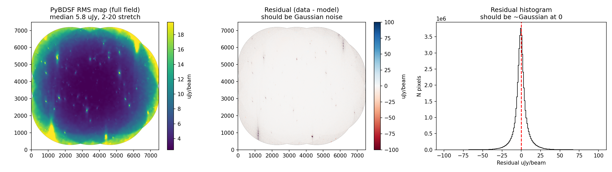
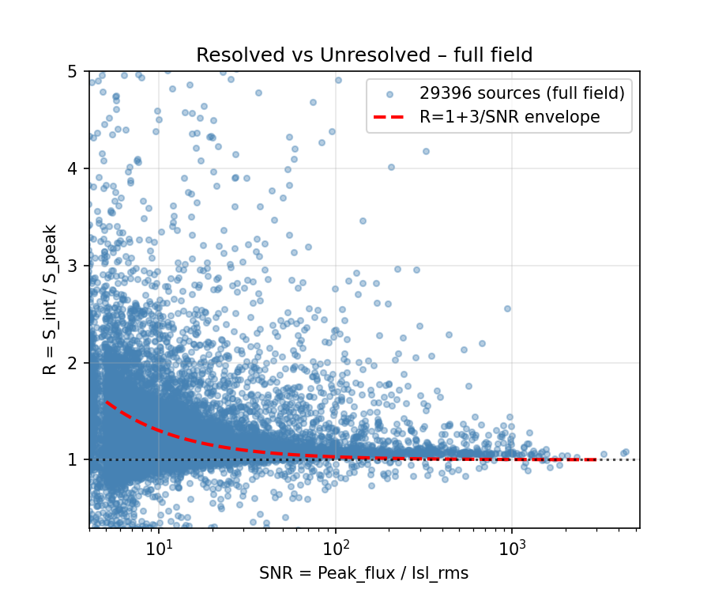
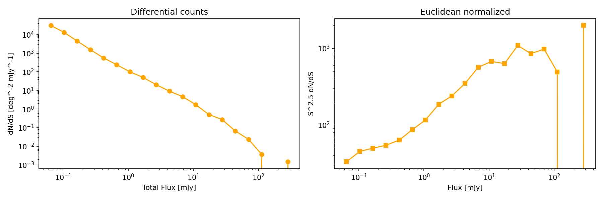

# Radio Source Finding with PyBDSF on MIGHTEE

> RAAP Univen / SARAO workshop: source extraction, quality control, and multi-wavelength cross-matching on MeerKAT MIGHTEE data.

Main notebook: [`PyBDSF_MIGHTEE.ipynb`](PyBDSF_MIGHTEE.ipynb) (~3 h, intermediate Python / Astropy).

## Overview

Hands-on with the MIGHTEE Continuum DR1 COSMOS 5.2″ Stokes-I image:

- **Telescope:** MeerKAT — 64 × 13.5 m dishes in the Karoo, SKA-MID precursor (L-band 856–1712 MHz used here, centred at 1.284 GHz).
- **Survey:** MIGHTEE — ~20 deg² (COSMOS 4.2, XMM-LSS 14.4, CDFS 1.5), µJy-level continuum / spectral-line / polarisation / H I. DR1 high-res ~5″.
- **Image used:** `MIGHTEE_Continuum_DR1_COSMOS_5p2arcsec_I_v1.1.fits` — 7486×7486, 1.1″/pix, 5.2″ circular beam, Jy/beam, ~428 MB–2 GB depending on cutout/full field.
- **Tool:** [PyBDSF](https://pybdsf.readthedocs.io/) — islands (`thresh_isl`) + Gaussian fitting (`thresh_pix`), adaptive rms box, à trous wavelets for extended emission.

Pipeline in the main notebook: inspect header / beam / WCS → cutout noise stats → full-field rms map → `bdsf.process_image` → diagnostics (residual, `S_int/S_peak` vs SNR, inverted map) → source counts `dN/dS` → cross-match via `astroquery` (SIMBAD, AllWISE II/328, COSMOS2020, VLA-COSMOS 3 GHz).

## Learning Outcomes

1. Inspect a MeerKAT image — header, WCS, beam, noise.
2. Explain PyBDSF islands + Gaussian fitting.
3. Run tuned PyBDSF + assess residuals.
4. Reliability checks — inverted map, resolved criterion `R > 1 + 3/SNR` where `R = S_int/S_peak`, `SNR = Peak/Isl_rms`.
5. Source counts / flux distributions — `dN/dS`, Euclidean `S^2.5 dN/dS`.
6. Cross-match via `astroquery` — SIMBAD, VizieR (COSMOS2020, AllWISE, VLA-COSMOS), CDS X-Match.
7. Publication-quality diagnostics.

## Repo Layout

```text
.
├── PyBDSF_MIGHTEE.ipynb   # main teaching notebook (RAAP Univen)
├── LICENSE                # MIT license
├── pyproject.toml         # uv / pip deps (Python >=3.10)
├── requirements.txt       # pip fallback (generated from pyproject)
├── Makefile               # uv helpers: install, notebook
├── data/
│   ├── images/            # input FITS (gitignored, large) — see Data
│   │   └── MIGHTEE_Continuum_DR1_COSMOS_5p2arcsec_I_v1.1.fits
│   └── catalog/           # PyBDSF outputs (FITS/CSV gitignored, PNGs committed)
│       ├── MIGHTEE_COSMOS_pybdsf_srl.fits / .csv
│       ├── MIGHTEE_COSMOS_pybdsf_gaul.fits
│       ├── rms_map.fits / resid_map.fits / model_map.fits
│       ├── diag_rms_resid.png / diag_flux_ratio.png / source_counts.png
└── README.md
```

## Quickstart

Requires Python 3.10+ (~8–16 GB RAM, 1–2 h for full-field PyBDSF).

### Option A — uv (recommended)

```bash
uv venv --python 3.10
source .venv/bin/activate
uv sync
jupyter notebook PyBDSF_MIGHTEE.ipynb
```

Or via Make:

```bash
make install
make notebook
```

### Option B — pip fallback (workshop laptops / Colab)

```bash
python3.10 -m venv .venv && source .venv/bin/activate
pip install -r requirements.txt
jupyter notebook PyBDSF_MIGHTEE.ipynb
```

Colab cell (first code cell in notebook):

```python
# !pip install --quiet bdsf astropy astroquery matplotlib radio-beam seaborn scipy jupyter
```

## Data

Large FITS are **not committed** (see `.gitignore`). The notebook auto-downloads + caches if missing.

- **Download:** [SARAO archive](https://archive-gw-1.kat.ac.za/public/repository/10.48479/7msw-r692/data/MIGHTEE_Continuum_DR1_COSMOS_5p2arcsec_I_v1.1.fits) (~1.3–2 GB full, ~428 MB cached FITS) and [IDIA gateway](https://gateway.idia.ac.za/pages/mightee-the-continuum-survey-data-release-1/).
- **Expected cache:**
  - Input: `data/images/MIGHTEE_Continuum_DR1_COSMOS_5p2arcsec_I_v1.1.fits`
  - Outputs: `data/catalog/MIGHTEE_COSMOS_pybdsf_{srl.fits,srl.csv,gaul.fits,rms_map.fits,resid_map.fits,model_map.fits}`

If `data/images/*.fits` is missing, §3 of the notebook fetches it with `astropy.utils.data.download_file(..., cache=True)` — just run the cell.

## Workflow (PyBDSF_MIGHTEE.ipynb §1–13)

1. **Background** — MeerKAT / MIGHTEE / PyBDSF, Condon (1997, 1998), Shimwell et al. (LoTSS).
2. **Setup** — `python==3.10`, `bdsf, astropy, astroquery, radio-beam, matplotlib`.
3. **Download** — fetch DR1 COSMOS image if not cached.
4. **Header / Beam / WCS** — `BMAJ/BMIN/BPA, CDELT, CRVAL, BUNIT`, 5.2″ beam, `WCS` + `Cutout2D`.
5. **First look** — central 1000×1000 cutout (`sigma_clipped_stats` ≈ −0.5 / 2.43 µJy/beam, peak 5.08 mJy/beam), `inferno` image, pixel histogram, 1:20 downsampled full field.
6. **Noise theory** — coarse rms demo (`box=100, step=50`, median ~2.5 µJy/beam), `rms_box`, `thresh_isl/pix`, flux errors.
7. **Source finding** — full-field run (see params below) → ~18.5k islands, ~20.8k Gaussians, ~29k sources.
8. **Diagnostics** — `rms_map` vs `gaus_resid` panels + histogram; `R=S_int/S_peak` vs `SNR` with `R=1+3/SNR` envelope; inverted-map symmetry check.
9. **Catalog analysis** — log bins 0.05 mJy–max, `dN/dS/deg²`, Euclidean normalisation, RA–Dec scatter.
10. **Cross-match** — SIMBAD 5″ (3 brightest); AllWISE `II/328` 10′ `<2″` → 23/29,396 (0.1% — shallow IR vs deep radio); COSMOS2020 + VLA 3 GHz `J/A+A/602/A1` → 527/29,396, `α=log(S1.28/S3)/log(1.28/3)`, median −0.80.
11. **Science plots** — `S_peak` vs `S_int`, astrometric `dRA/dDec`, `Maj` vs `S_int`, mag vs flux, `α` vs `z_phot (lpzBEST)`.
12. **Exercises** — 7 graded tasks (see below).
13. **References** — BibTeX in-notebook.

### Key PyBDSF Params (teaching run, cell 16)

```python
img = bdsf.process_image(
    str(fits_path),
    thresh_isl=3.0, thresh_pix=5.0,
    rms_box=(150, 15), rms_box_bright=(60, 15),
    adaptive_rms_box=True, adaptive_thresh=150,
    mean_map='zero',
    atrous_do=True, atrous_jmax=3,
    group_by_isl=False, group_tol=10.0,
    flagging_opts=True, flag_maxsize_fwhm=0.5,
    frequency=1.284e9, beam=(5.2/3600, 5.2/3600, 0.0),
)
img.write_catalog(outfile="data/catalog/MIGHTEE_COSMOS_pybdsf_srl.fits", format='fits', clobber=True)
img.write_catalog(outfile="data/catalog/MIGHTEE_COSMOS_pybdsf_srl.csv", format='csv', clobber=True)
img.export_image(outfile="data/catalog/rms_map.fits", img_type='rms', clobber=True)
img.export_image(outfile="data/catalog/resid_map.fits", img_type='gaus_resid', clobber=True)
```

Tune `thresh_pix` (reliability vs depth), `rms_box` / `rms_box_bright` (bright-source artefacts), `atrous_do` (extended doubles).

## Outputs & Diagnostics

Generated in `data/catalog/` (FITS/CSV ignored, PNGs committed for preview):

| File | Description |
|------|-------------|
| `MIGHTEE_COSMOS_pybdsf_srl.fits` / `.csv` | Source catalog (~29k rows: `Source_id, RA/E_RA, DEC/E_DEC, Peak/E_Peak, Total/E_Total, Maj/Min/PA, Isl_rms`) |
| `MIGHTEE_COSMOS_pybdsf_gaul.fits` | Gaussian-component catalog |
| `rms_map.fits` / `resid_map.fits` / `model_map.fits` | Noise / Gaussian-residual / model images |
| `diag_rms_resid.png` | rms vs residual panels + histogram |
| `diag_flux_ratio.png` | `S_int/S_peak` vs SNR + resolved envelope |
| `source_counts.png` | `dN/dS`, Euclidean counts, sky distribution |





Inverted-map test in notebook: detections on `−image` give false-positive estimate, `FDR = N_inverted / N_real`.

## Exercises

Beginner: `thresh_pix = 4.0/5.0/6.0` completeness vs FDR; `atrous_do True/False` on double-lobed source near RA 10:01:00.
Intermediate: inject 100 fake points at 50/100/200 µJy for `C(S)`; spectral-index classify 527 VLA matches (SFG `-1.2<α<-0.5`, flat AGN `α>-0.3`, ultra-steep `α<-1.2`).
Advanced: Euclidean `S^2.5 dN/dS` over 1.6 deg² vs Hale et al. 2025 Fig.12; bright-source rms tuning; own island finder with `scipy.ndimage.label`. Plus Hale DR1 comparison task.

## References

- Jonas et al. 2016 — MeerKAT; Jarvis et al. 2017 [1709.01901] — MIGHTEE; Heywood et al. 2022 MNRAS 510,412 — DR1; Hale et al. 2025 [2411.04958] MNRAS 536,2187 — DR1 catalog.
- Mohan & Rafferty 2015 [ascl:1502.007] — PyBDSF; Condon 1997 PASP 109,166; Condon et al. 1998 AJ 115,1693; Shimwell et al. 2019 LoTSS; Smolčić et al. 2017 VLA-COSMOS; Weaver et al. 2022 COSMOS2020.
- Links: [MIGHTEE](https://www.mighteesurvey.org/) · [PyBDSF docs](https://pybdsf.readthedocs.io/) · [astroquery docs](https://astroquery.readthedocs.io/) · [IDIA DR1 gateway](https://gateway.idia.ac.za/pages/mightee-the-continuum-survey-data-release-1/)

## License / Authors

MIT — see [`LICENSE`](LICENSE). © 2026 Emmanuel Ocran / Daniel Egbo.

Workshop context: SARAO / RAAP Univen. MIGHTEE image `COMMENT 2024-10-23`; MIGHTEE data credit Hale et al. 2025 + IDIA/SARAO.
